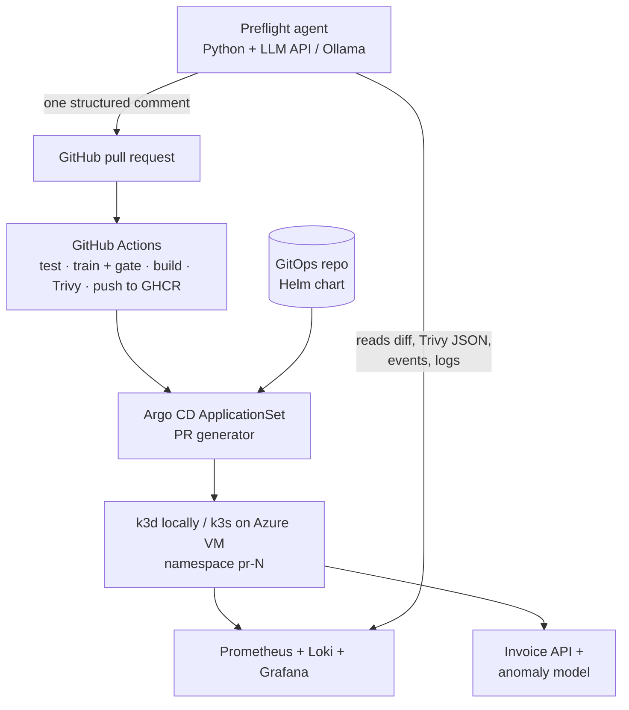

# Preflight

[](https://github.com/elyesmanai911/preflight/actions/workflows/ci.yml)

**Preview environments for every pull request, plus an AI release agent that explains them.**

Preflight is a GitOps platform where every pull request automatically gets an ephemeral
Kubernetes environment serving that PR's version of an ML model. An AI release agent then posts
one PR comment that risk-scores the diff, compares model metrics against `main`, summarizes
security scan findings, triages failed deployments from live logs, and estimates the
environment's cost. When the PR closes, the environment is torn down.

> 🚧 **Status: Phase 4 of 7.** Every PR gets a preview environment serving its own model, and an AI-written report; the platform is being
> built phase by phase. Each phase ends with a tagged release; see the roadmap below.

## How it will work

1. A developer opens a PR on the demo app.
2. **CI** (GitHub Actions): lint → test → train model + quality gate → build image → Trivy scan → push to GHCR.
3. **GitOps** (Argo CD ApplicationSet, Pull Request generator): deploys the image into an
   isolated namespace `pr-<number>` with its own URL.
4. **AI release agent** (Python, any OpenAI-compatible LLM: a free API tier in CI, Ollama
   self-hosted locally) posts a single PR comment:
   - 🔗 preview URL and deploy status
   - 🧠 diff risk summary: what changed, blast radius, what to test
   - 📈 model report: precision / recall / F1 vs `main`
   - 🛡️ security digest: Trivy CVEs as "fix now / can wait"
   - 🔥 failure triage, if the deploy fails: root cause from pod events and Loki logs
   - 💰 cost estimate for the preview environment
5. PR merged or closed → namespace destroyed (a TTL reaper acts as a backstop).

## Architecture



## The demo app

A small **invoice API** (FastAPI) with an **anomaly-detection model** (scikit-learn). It echoes
real e-invoicing integration work and gives the platform a real model lifecycle to ship.

| Endpoint | Purpose |
|---|---|
| `GET /health` | liveness check |
| `POST /invoices` | validate an invoice, compute totals (TND, 3 decimals), score it: `anomaly_score`, `flagged` |
| `GET /invoices/{id}` | fetch a stored invoice |

### The model lifecycle

| Step | Where |
|---|---|
| **Data:** seeded synthetic invoices with labelled anomalies (invalid VAT rate, inflated price or quantity) | `ml/data.py` |
| **Features:** one function shared by training and the API, so they can't drift apart | `ml/features.py` |
| **Train + evaluate:** RandomForest → `model.joblib` + `metrics.json` (precision, recall, F1) | `ml/train.py` |
| **Quality gate:** F1 below 0.80 fails CI and the image build | `ml/train.py`, CI, Dockerfile |
| **Version:** the model is trained inside the image build, so image tag = commit SHA = model version | `Dockerfile` |
| **Deploy per PR:** each preview environment serves that PR's model | ApplicationSet |

```bash
.venv/bin/python -m ml.train   # writes model/model.joblib and model/metrics.json
```

### Run it locally

```bash
python3 -m venv .venv
.venv/bin/pip install -r requirements.txt -r requirements-dev.txt
.venv/bin/python -m pytest -q
.venv/bin/uvicorn app.main:app --reload   # http://localhost:8000/docs
```

### Run it in Docker

```bash
docker build -t preflight-app:dev .
docker run --rm -p 8000:8000 preflight-app:dev
```

## The release agent

`agent/review.py` writes one **Preflight report** comment per PR, edited in place on every push.
**Facts are computed in code** (preview URL, metric table vs `main`, CVE counts); **the LLM only
adds judgement** (risk level, what to test, which CVEs to fix now, what a metric change means).
If the LLM fails or is rate-limited (after 2 retries), the comment still posts with the facts.

It speaks plain HTTP to any OpenAI-compatible `/chat/completions` endpoint:

| Setting | CI (default) | Local, self-hosted |
|---|---|---|
| `LLM_BASE_URL` | `https://generativelanguage.googleapis.com/v1beta/openai` | `http://localhost:11434/v1` |
| `LLM_MODEL` | repo variable, currently `gemini-flash-lite-latest` | `qwen2.5:3b` |
| `LLM_API_KEY` | repo secret | not needed |
| `LLM_TIMEOUT` | 180 s | 900 s (CPU inference) |

Requests use JSON mode (`response_format: json_object`): without it, Gemini sometimes answered in
Markdown even when told to return JSON.

### Run it against Ollama

```bash
curl -fsSL https://ollama.com/install.sh | OLLAMA_VERSION=0.40.13 sh
# Ollama's default context (~2K tokens) silently truncates the prompt; raise it:
sudo mkdir -p /etc/systemd/system/ollama.service.d
printf '[Service]\nEnvironment="OLLAMA_CONTEXT_LENGTH=8192"\n' | sudo tee /etc/systemd/system/ollama.service.d/context.conf
sudo systemctl daemon-reload && sudo systemctl restart ollama
ollama pull qwen2.5:3b

gh pr diff <N> > pr.diff
LLM_BASE_URL=http://localhost:11434/v1 LLM_MODEL=qwen2.5:3b LLM_TIMEOUT=900 \
  python -m agent.review --diff pr.diff --trivy trivy.json --metrics model/metrics.json \
  --preview-url http://pr-<N>.preview.127.0.0.1.nip.io:8080 --image local
```

### Hosted vs self-hosted, measured on the same PR

| | Gemini Flash-Lite (free tier) | qwen2.5:3b on Ollama (2 CPUs, 6 GB VM) |
|---|---|---|
| Time | ~5 s | ~3–5 min (4.3K prompt tokens at ~25 tok/s) |
| Understood the diff | yes | vague |
| Stated facts correctly | yes | run 1 claimed a metric drop that didn't happen; run 2 claimed there were no HIGH CVEs (there are 52) |
| CVE triage | selective | run 1 listed 15 CVEs as "fix now"; run 2 said "nothing urgent" |
| Data leaves the machine | yes | no |

The small local model proves the agent runs fully self-hosted, but it isn't a reliable reviewer.
That's why the numbers in the comment never come from the LLM.

## Run the platform locally

Needs Docker, [k3d](https://k3d.io), kubectl and Helm.

```bash
# 1. Cluster: port 8080 on your machine → the cluster's Traefik ingress
k3d cluster create preflight -p '8080:80@loadbalancer' --wait

# 2. Argo CD
helm repo add argo https://argoproj.github.io/argo-helm
helm upgrade --install argocd argo/argo-cd --version 10.11.6 \
  -n argocd --create-namespace -f platform/argocd/values.yaml --wait

# 3. One preview environment per open PR
kubectl apply -f platform/argocd/preview-appset.yaml
```

Open a PR: within about 2 minutes, Argo CD deploys it to namespace `pr-<N>` and CI comments the
URL, `http://pr-<N>.preview.127.0.0.1.nip.io:8080`. Close the PR and the namespace is deleted.

Argo CD UI: `kubectl -n argocd port-forward svc/argocd-server 8081:80`, then open
http://localhost:8081 as `admin` with the password from
`kubectl -n argocd get secret argocd-initial-admin-secret -o jsonpath='{.data.password}' | base64 -d`.

## Roadmap

- [x] **Phase 0: skeleton and story.** README, demo app, Dockerfile, tests (`v0.1`)
- [x] **Phase 1: CI pipeline.** GitHub Actions, GHCR, Trivy with SARIF, branch protection (`v0.2`)
- [x] **Phase 2: preview environments.** k3d, Argo CD ApplicationSet PR generator, Helm, per-PR ingress (`v0.3`)
- [x] **Phase 3: model lifecycle.** synthetic data, training, quality gate, model versioned per image and per PR (`v0.4`)
- [x] **Phase 4: AI agent v1.** diff risk, CVE digest, model report; free LLM API in CI, Ollama locally (`v0.5`)
- [ ] **Phase 5: AI incident triage + monitoring.** Prometheus, Loki, prediction metrics, root-cause comments on broken PRs (`v0.6`)
- [ ] **Phase 6: FinOps and guardrails.** cost estimate, ResourceQuota, TTL reaper (`v0.7`)
- [ ] **Phase 7: cloud demo.** Terraform on Azure, Key Vault with External Secrets, demo video (`v1.0`)

### Out of scope (on purpose)

Multi-cluster or service mesh; fine-tuned LLMs or GPU serving (Ollama is a local CPU option
only); MLOps heavyweights such as MLflow, Kubeflow, KServe or feature stores; a custom dashboard
(the PR comment *is* the UI); supporting arbitrary apps; and a Go operator. These are possible v2
directions, not v1 work.
