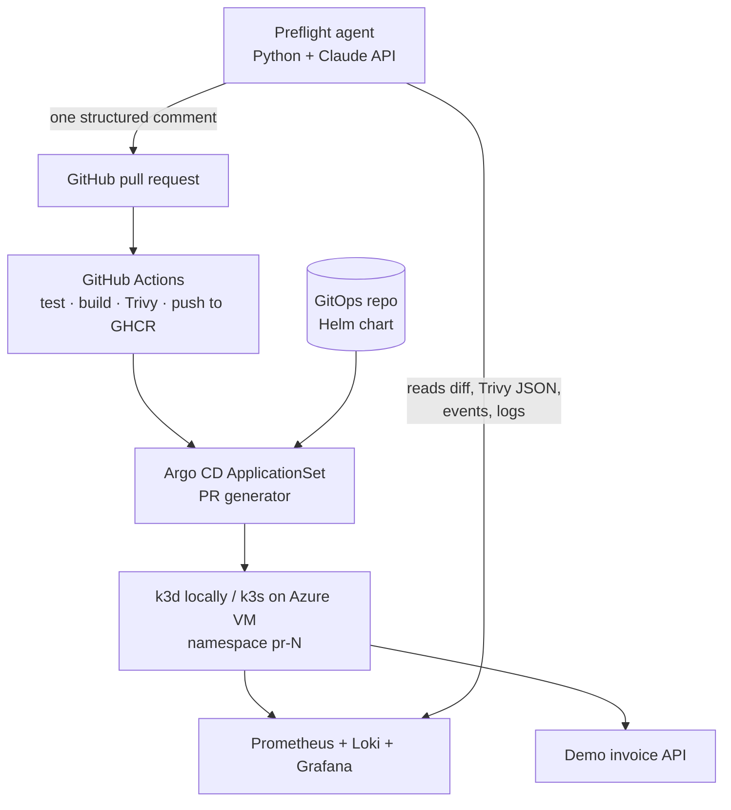

# Preflight

[](https://github.com/elyesmanai911/preflight/actions/workflows/ci.yml)

**Preview environments for every pull request, plus an AI release agent that explains them.**

Preflight is a GitOps platform where every pull request automatically gets an ephemeral
Kubernetes environment. An AI release agent then posts one PR comment that risk-scores the
diff, summarizes security scan findings, triages failed deployments from live logs, and
estimates the environment's cost. When the PR closes, the environment is torn down.

> 🚧 **Status: Phase 1 of 6.** The demo app and its CI pipeline are in place; the platform is being
> built phase by phase. Each phase ends with a tagged release; see the roadmap below.

## How it will work

1. A developer opens a PR on the demo app.
2. **CI** (GitHub Actions): lint → test → build image → Trivy scan → push to GHCR.
3. **GitOps** (Argo CD ApplicationSet, Pull Request generator): deploys the image into an
   isolated namespace `pr-<number>` with its own URL.
4. **AI release agent** (Python + Claude API) posts a single PR comment:
   - 🔗 preview URL and deploy status
   - 🧠 diff risk summary: what changed, blast radius, what to test
   - 🛡️ security digest: Trivy CVEs as "fix now / can wait"
   - 🔥 failure triage, if the deploy fails: root cause from pod events and Loki logs
   - 💰 cost estimate for the preview environment
5. PR merged or closed → namespace destroyed (a TTL reaper acts as a backstop).

## Architecture



## The demo app

A small **invoice API** (FastAPI). It echoes real e-invoicing integration work: validation
and VAT totals now; signing, QR codes and Postgres in later phases. It also gives the AI agent
realistic failures to diagnose, such as a missing certificate, a failed validation, or a broken
DB migration.

| Endpoint | Purpose |
|---|---|
| `GET /health` | liveness check |
| `POST /invoices` | validate an invoice, compute totals (TND, 3 decimals) |
| `GET /invoices/{id}` | fetch a stored invoice |

### Run it locally

```bash
python3 -m venv .venv
.venv/bin/pip install -r requirements.txt -r requirements-dev.txt
.venv/bin/python -m pytest -q
.venv/bin/uvicorn app.main:app --reload   # http://localhost:8000/docs
```

### Run it in Docker

```bash
docker build -t preflight-app:dev .
docker run --rm -p 8000:8000 preflight-app:dev
```

## Roadmap

- [x] **Phase 0: skeleton and story.** README, demo app, Dockerfile, tests (`v0.1`)
- [x] **Phase 1: CI pipeline.** GitHub Actions, GHCR, Trivy with SARIF, branch protection (`v0.2`)
- [ ] **Phase 2: preview environments.** k3d, Argo CD ApplicationSet PR generator, Helm, per-PR ingress (`v0.3`)
- [ ] **Phase 3: AI agent v1.** diff risk summary and CVE digest as a PR comment (`v0.4`)
- [ ] **Phase 4: AI incident triage.** Prometheus, Loki, root-cause comments on broken PRs (`v0.5`)
- [ ] **Phase 5: FinOps and guardrails.** cost estimate, ResourceQuota, TTL reaper (`v0.6`)
- [ ] **Phase 6: cloud demo.** Terraform on Azure, Key Vault with External Secrets, demo video (`v1.0`)

### Out of scope (on purpose)

Multi-cluster or service mesh, self-hosted or fine-tuned LLMs, a custom dashboard (the PR
comment *is* the UI), supporting arbitrary apps, and a Go operator. These are possible v2
directions, not v1 work.
